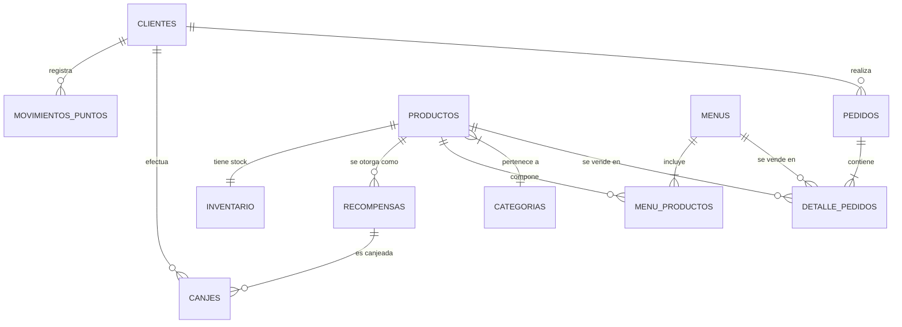

# Guía Maestra para la Defensa del Proyecto: Subnotway

> **Proyecto:** Sistema de Pedidos y Fidelización "Pan, Puntos y Premios"  
> **Curso:** Programación II — Universidad Mariano Gálvez de Guatemala (UMG)  
> **Stack:** Java 17+, Spring Boot (Web MVC, REST API), Thymeleaf, Bootstrap 5, MySQL, Android Nativo (Java).

---

## 1. Resumen Ejecutivo (El "Elevator Pitch")

> *"Subnotway es una solución tecnológica integral diseñada para optimizar tanto la operación interna de un restaurante de comida rápida como la lealtad y retención de clientes. Consta de dos componentes clave: una **plataforma web administrativa y de punto de venta (POS)** construida sobre Spring Boot y Thymeleaf, y una **aplicación móvil Android nativa** que permite a los clientes consultar su saldo de puntos en tiempo real a través de una API REST segura."*

### Los 5 Módulos Principales:
1. **Terminal de Ventas (POS):** Toma de pedidos con catálogo reactivo, control de precios, cálculo de cambio y acumulación automática de puntos.
2. **Gestión de Productos e Inventario:** Control de catálogo, ingredientes, recetas de menús y alertas de stock mínimo.
3. **Directorio de Clientes:** Registro, consulta y mantenimiento de clientes con identificación única (NIT/DPI).
4. **Módulo de Fidelización:** Consulta de saldo, simulador de acumulación y canje de recompensas según catálogo activo.
5. **Reportes Oficiales en PDF:** Generación en tiempo real de reportes gerenciales (ventas por período, productos más vendidos, stock crítico y balance de canjes).
6. **Componente Móvil (Android + REST):** Consulta desacoplada y remota de beneficios para el consumidor.

---

## 2. Arquitectura de Software y Patrones de Diseño

El proyecto implementa una arquitectura en capas desacopladas con separación estricta de responsabilidades:

```mermaid
graph TD
    subgraph "Clientes / Frontend"
        Browser["Navegador Web (Thymeleaf + Bootstrap 5)"]
        AndroidApp["App Móvil Android (Native Java)"]
    end

    subgraph "Capa Controladora (Presentation / API)"
        WebControllers["Spring Web MVC Controllers (Ventas, Clientes, Fidelización)"]
        RestController["ClienteApiController (@RestController / JSON)"]
    end

    subgraph "Capa de Negocio (Service Layer)"
        FidService["FidelizacionService (Reglas de Negocio, Transacciones)"]
    end

    subgraph "Capa de Acceso a Datos (DAO Layer)"
        DAOs["ClienteDAO, CanjeDAO, ProductoDAO, PedidoDAO"]
        DBPool["ConexionDB (JDBC Connection Pool)"]
    end

    subgraph "Persistencia"
        MySQL[("MySQL Database (pan_puntos_premios)")]
    end

    Browser -->|HTTP GET/POST / HTML| WebControllers
    AndroidApp -->|HTTP GET / JSON (REST)| RestController
    WebControllers --> FidService
    RestController --> DAOs
    FidService --> DAOs
    DAOs --> DBPool
    DBPool --> MySQL
```

### Patrones Aplicados:
- **MVC (Modelo - Vista - Controlador):** Desacopla la lógica de datos (`modelo/`), la presentación visual (`templates/`) y el flujo de control (`controlador/`).
- **DAO (Data Access Object):** Aísla las sentencias SQL y la conexión física a la base de datos de la lógica de negocio. Si el motor de datos cambiara, solo se modifica el DAO.
- **Service Layer (Capa de Servicio):** Centraliza las reglas del negocio (`FidelizacionService`). Los controladores son *"delgados"* (Thin Controllers): solo reciben la petición HTTP, delegan el procesamiento al servicio y retornan la vista o el JSON.
- **REST (Representational State Transfer):** `ClienteApiController` expone un recurso JSON sin estado (*stateless*), consumible por cualquier plataforma cliente (móvil, web, quiosco).
- **Asincronía (Multi-threading en Android):** Uso de `ExecutorService` para la petición HTTP de red fuera del hilo principal (*Background Thread*) y `Handler(Looper.getMainLooper())` para pintar la UI en el *Main Thread*.

---

## 3. Reglas de Negocio Clave (¡Preguntas Frecuentes!)

### A. Algoritmo de Acumulación de Puntos:
- **Fórmula matemática oficial:**
  $$\text{Puntos} = (\text{Cantidad de Sándwiches} \times 2) + (\text{Cantidad de Menús} \times 8)$$
- **¿Por qué esta relación?** Premia las compras de mayor margen o combos completos (menú incluye bebida/acompañamiento), fomentando el ticket promedio más alto.
- **¿Dónde se ejecuta?** En `FidelizacionService.calcularPuntos(int sandwiches, int menus)` y al cerrar un pedido en `VentaService` / `VentaController`.

### B. Proceso de Canje de Recompensas:
1. Se valida que el cliente exista y esté en estado `ACTIVO`.
2. Se verifica que la recompensa esté activa y que:
   $$\text{Saldo Cliente} \ge \text{Costo en Puntos de la Recompensa}$$
3. Si el saldo es suficiente:
   - Se descuentan los puntos del saldo del cliente.
   - Se crea un registro en la tabla `canjes` con sello de tiempo (`CURRENT_TIMESTAMP`).
   - Se genera una auditoría en `movimientos_puntos` con tipo `'CANJE'`.
   - Se descuenta el componente del inventario correspondiente.
4. Si el saldo es insuficiente, la transacción se rechaza y se notifica al usuario sin alterar el balance.

---

## 4. Estructura de la Base de Datos Relacional

La base de datos `pan_puntos_premios` en MySQL está normalizada (3FN) con motor **InnoDB**, soportando transacciones ACID e integridad referencial estricta.



### Tablas y Propósitos:
- `clientes`: Datos maestros del cliente, NIT/DPI único y saldo acumulado persistido de puntos.
- `productos` y `categorias`: Catálogo de ítems individuales (panes, bebidas, postres) con precio y costo.
- `menus` y `menu_productos`: Combos armados con sus ítems integrantes (receta/composición).
- `inventario` y `movimientos_inventario`: Existencias físicas en tiempo real y kardex de entradas/salidas.
- `pedidos` y `detalle_pedidos`: Cabecera y líneas de venta con cálculo de subtotales, impuestos y puntos generados.
- `recompensas`: Catálogo de premios con costo en puntos requerido.
- `canjes`: Transacciones históricas de redención de premios.
- `movimientos_puntos`: Libro mayor (*ledger*) de auditoría (entradas por compra, salidas por canje).

---

## 5. El Componente Móvil Android

### Detalles Técnicos:
- **Lenguaje:** Java 17 / SDK compilación 34.
- **Componentes de UI:** `MaterialCardView`, `TextInputEditText`, `MaterialButton`, `ProgressBar`.
- **Conectividad:** `HttpURLConnection` con timeout de 6 segundos y parseo nativo con `org.json.JSONObject`.
- **IP Especial `10.0.2.2`:** Es la dirección de loopback que el emulador de Android utiliza para alcanzar el `localhost:8080` de la máquina host del desarrollador.

---

## 6. Preguntas "Trampa" de Catedráticos y Cómo Responderlas

### P1: *"¿Por qué no conectaron la app de Android directamente a MySQL con JDBC?"*
> **Respuesta ideal:**  
> *"Conectar un dispositivo móvil directamente a la base de datos es una pésima práctica de seguridad y arquitectura. Expondría las credenciales de la base de datos (usuario y contraseña de MySQL) dentro del código compilado (APK), permitiría inyecciones SQL directas si se intercepta el tráfico, y saturaría las conexiones de la base de datos. Usamos una **API REST intermedia**, lo que permite autenticar, validar reglas de negocio en el servidor y mantener la base de datos protegida en una red privada."*

### P2: *"¿Dónde está la lógica de negocio: en la base de datos, en el controlador o en el servicio?"*
> **Respuesta ideal:**  
> *"En la **capa de servicio (`FidelizacionService`)**. Los controladores se mantienen livianos (Thin Controllers) dedicándose únicamente a recibir solicitudes y devolver vistas o JSON. Tampoco sobrecargamos la base de datos con stored procedures complejos para que la lógica sea testeable mediante pruebas unitarias en Java y fácilmente portable."*

### P3: *"¿Qué sucede si dos usuarios intentan canjear puntos al mismo tiempo?"*
> **Respuesta ideal:**  
> *"El motor de base de datos InnoDB maneja bloqueos a nivel de fila (*row-level locking*) y transacciones con nivel de aislamiento. Además, en la capa de servicio se realiza la validación previa de saldo suficiente antes de ejecutar la actualización. La operación de descuento es atómica sobre el registro del cliente."*

### P4: *"¿Cómo funciona Thymeleaf y por qué no usar JSP?"*
> **Respuesta ideal:**  
> *"Thymeleaf es un motor de plantillas moderno que trabaja con **HTML5 puro** (natural templates). A diferencia de JSP, los archivos `.html` de Thymeleaf se pueden previsualizar directamente en cualquier navegador sin necesidad de levantar un servidor. Además, se integra de manera nativa y recomendada con Spring Boot 3.x, cuenta con protección automática contra ataques XSS (Cross-Site Scripting) y procesa los atributos `th:*` en el servidor antes de entregar el HTML limpio al cliente."*

### P5: *"¿Qué formato de identificación acepta el sistema para los clientes?"*
> **Respuesta ideal:**  
> *"El sistema acepta tanto NIT como DPI o códigos internos de cliente (`CL-001`, `CL-002`). La API REST cuenta además con normalización de cadenas, permitiendo resolver búsquedas tanto con guiones como sin ellos para mejorar la experiencia del usuario final."*

---

## 7. Guía Paso a Paso para la Demostración en Vivo (Demo)

Si los evaluadores piden una demostración en vivo, este es el orden ideal con mayor impacto:

1. **Mostrar la Terminal de Ventas (`/ventas`):**
   - Seleccionar un cliente de prueba (`CL-001 - Juan Carlos Perez`).
   - Agregar 1 Menú Subnotway y 1 Sándwich al carrito.
   - Mostrar el total y hacer clic en **Cobrar**.
   - Resaltar cómo se calcula el cambio y cómo se suman **+10 puntos** (8 por menú + 2 por sándwich).
2. **Mostrar la Consulta Móvil en el Emulador Android:**
   - Abrir la app en el emulador.
   - Ingresar el identificador `CL-001`.
   - Presionar **CONSULTAR SALDO**.
   - Mostrar cómo los puntos acumulados en la venta recién hecha se reflejan en tiempo real en la pantalla del celular.
3. **Mostrar el Módulo de Fidelización Web (`/fidelizacion`):**
   - Ver el cliente seleccionado.
   - Demostrar el canje de una recompensa (ej. "Bebida Gratis" o "Galleta").
   - Mostrar cómo el historial de canjes y movimientos se actualiza de inmediato.
4. **Mostrar los Reportes en PDF (`/reportes`):**
   - Hacer clic en descargar el reporte de **Ventas por Período** o **Balance de Fidelización**.
   - Abrir el PDF generado para mostrar el diseño formal, tablas y totales calculados.
